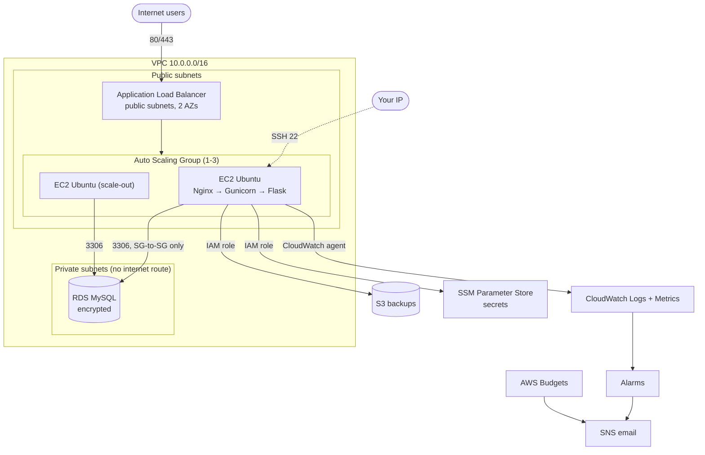

# Secure Banking Fraud Detection System

A Python Flask-based banking fraud detection application designed with security, scalability, and cloud deployment in mind.

The system analyzes banking transactions using rule-based fraud detection and flags suspicious activities based on transaction amount and country. It includes secure user authentication, CSRF protection, login attempt lockout, role-based admin access, and audit logging.

The project is designed for AWS deployment using Terraform, with infrastructure components including EC2, RDS MySQL, S3, IAM, Application Load Balancer, Auto Scaling, and CloudWatch.

### Key Features
- **Fraud Detection:** Rule-based analysis to identify suspicious banking transactions.
- **Secure Authentication:** Password hashing, CSRF protection, and login lockout.
- **Admin Dashboard:** Role-based administrative access and transaction monitoring.
- **Audit Logging:** Tracks user activities and security events.
- **Database Management:** SQL database integration with MySQL support.
- **AWS Infrastructure:** Infrastructure provisioning using Terraform.
- **Cloud Monitoring:** Centralized logging, CloudWatch metrics, and alarms.
- **Automated Testing:** Pytest test suite and GitHub Actions CI workflow.

### Technology Stack
Python | Flask | MySQL | SQL | AWS EC2 | AWS RDS | AWS S3 | IAM | CloudWatch | Terraform | Git | GitHub Actions | Pytest

## Architecture



You can recreate this in draw.io (free; there is a VS Code extension listed in `.vscode/extensions.json`) and save it as `docs/architecture.drawio`/`.png` for a polished diagram.

## Security controls

| Layer | Control |
|---|---|
| Network | DB in private subnets with **no route to the internet**; `publicly_accessible = false` |
| Security groups | ALB: 80/443 public. Web: port 80 **only from the ALB SG**, SSH **only from your IP**. DB: 3306 **only from the web SG** |
| IAM | EC2 role: read 3 SSM parameters, put/get under one S3 prefix, CloudWatch agent. **No access keys anywhere** |
| Secrets | DB password, Flask secret key and admin password generated by Terraform → SSM SecureString |
| Host | ufw firewall, fail2ban, unattended-upgrades, non-root `flaskapp` service user, systemd hardening, IMDSv2 only, encrypted EBS |
| App | Password hashing, CSRF tokens, login lockout (5 fails / 15 min), role-based admin, security headers, full **audit log** (DB + file shipped to CloudWatch) |
| Data | RDS & S3 encrypted, S3 public access blocked + versioning + 30-day lifecycle |

## Project layout

```
app/            Flask app (fraud rules, auth, audit logging, admin dashboard)
tests/          pytest suite
deploy/         setup_server.sh, nginx.conf, gunicorn, systemd unit, CloudWatch agent config
scripts/        backup.py (DB → S3), stress_test.py (auto-scaling demo)
terraform/      VPC, SGs, EC2/ASG/ALB, RDS, S3, IAM, CloudWatch, SNS, Budgets
.github/        CI: pytest + terraform validate
.vscode/        debug config & recommended extensions
docs/           cost estimate, screenshots
```

## 1. Run locally (VS Code)

```bash
python -m venv venv
source venv/bin/activate            # Windows: venv\Scripts\activate
pip install -r requirements-dev.txt
cp .env.example .env                # optional
export ADMIN_PASSWORD='ChangeMe!123'
flask --app wsgi init-db
flask --app wsgi run --debug        # or press F5 in VS Code ("Flask (local dev)")
pytest -q
```
Open http://127.0.0.1:5000 and log in as `admin`. Try a transaction with amount `20000` in country `IR` to see it flagged, then view `/admin`.

## 2. Push to GitHub

```bash
git init && git add . && git commit -m "Initial commit"
git branch -M main
git remote add origin https://github.com/<you>/secure-flask-aws.git
git push -u origin main
```
The repo must be **public** (or edit `user_data` to use a deploy token) because instances `git clone` it at boot. GitHub Actions will run the tests and `terraform validate`.

## 3. Deploy to AWS - the learning path

You can do this fully with Terraform (step 4), but doing it by hand once teaches the most. Build order:

1. **VPC** - 2 public + 2 private subnets, internet gateway, public route table (private has none). → `terraform/network.tf`
2. **EC2 + Nginx + Gunicorn** - launch Ubuntu 22.04 in a public subnet, then run
   `sudo REPO_URL=https://github.com/<you>/secure-flask-aws.git bash deploy/setup_server.sh`
   (updates, ufw, fail2ban, non-root user, systemd, Nginx). Without `DB_HOST` it uses SQLite.
3. **RDS** - MySQL in the private subnets; DB SG allows 3306 only from the web SG. Re-run the script with `DB_HOST`, `DB_NAME`, `DB_USER`, `DB_PASSWORD_PARAM` set.
4. **IAM role, S3, CloudWatch** - attach the instance profile; the script installs the CloudWatch agent (memory/disk metrics, nginx + audit logs) and a nightly `backup.py` cron.
5. **ALB + Auto Scaling** - target tracking on 50% average CPU, health check on `/health`.
6. **Stress test** (below), then screenshots, then write up.

## 4. Deploy with Terraform

Prereqs: AWS CLI configured (`aws configure`), Terraform ≥ 1.5.

```bash
cd terraform
cp terraform.tfvars.example terraform.tfvars     # set my_ip_cidr, alert_email, repo_url
terraform init
terraform plan
terraform apply
```
- Confirm the **SNS subscription email** AWS sends you (otherwise no alarm emails).
- Wait ~5 min for instances to boot, then open `app_url` from the outputs.
- Admin password: run the `get_admin_password_cmd` output.
- HTTPS: pass `certificate_arn` (ACM cert for your domain) and the ALB redirects 80 → 443.

## 5. Watch it scale

```bash
# in terraform.tfvars: enable_stress_endpoint = true  → terraform apply
python scripts/stress_test.py http://<alb-dns> --threads 40 --duration 600
```
Watch **EC2 → Auto Scaling groups → Activity** and **CloudWatch → Alarms**; you should see CPU climb, new instances launch (max 3), and an alert email. Stop the script and the group scales back in after ~15 min. **Set `enable_stress_endpoint = false` afterwards.**

## Screenshots to capture

`docs/screenshots/` → VPC resource map, security groups, ALB target health, ASG activity during the stress test, CloudWatch dashboard/alarm, S3 backup objects, the app's admin dashboard, the Budgets page.

## Backups & restore

`scripts/backup.py` writes `db-backups/backup-<timestamp>.sql.gz` to S3 (SSE, versioned, 30-day expiry). Restore: `aws s3 cp s3://<bucket>/db-backups/<file> . && gunzip -c <file> | mysql -h <rds-endpoint> -u fraudadmin -p frauddb`. (With several ASG instances every one runs the cron; harmless, but you could restrict it to one.)

## Cost & cleanup

See [docs/cost-estimate.md](docs/cost-estimate.md) (~$45-60/mo always-on). An AWS Budget emails you at 50%/80% actual and 100% forecast. **Run `terraform destroy` when done.**

## Known limitations / next steps

- Instances live in public subnets (SG-protected) to avoid NAT cost; production should use private subnets + NAT/VPC endpoints + SSM Session Manager instead of SSH.
- Single-AZ RDS; set `multi_az = true` for HA.
- Add WAF on the ALB, remote Terraform state (S3 + DynamoDB lock), and a CloudWatch dashboard.
- Rule-based fraud scoring is for demonstration; swap in an ML model later.
